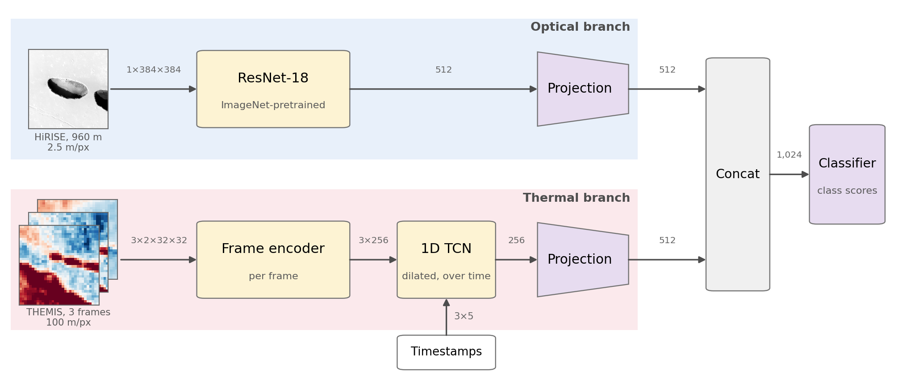
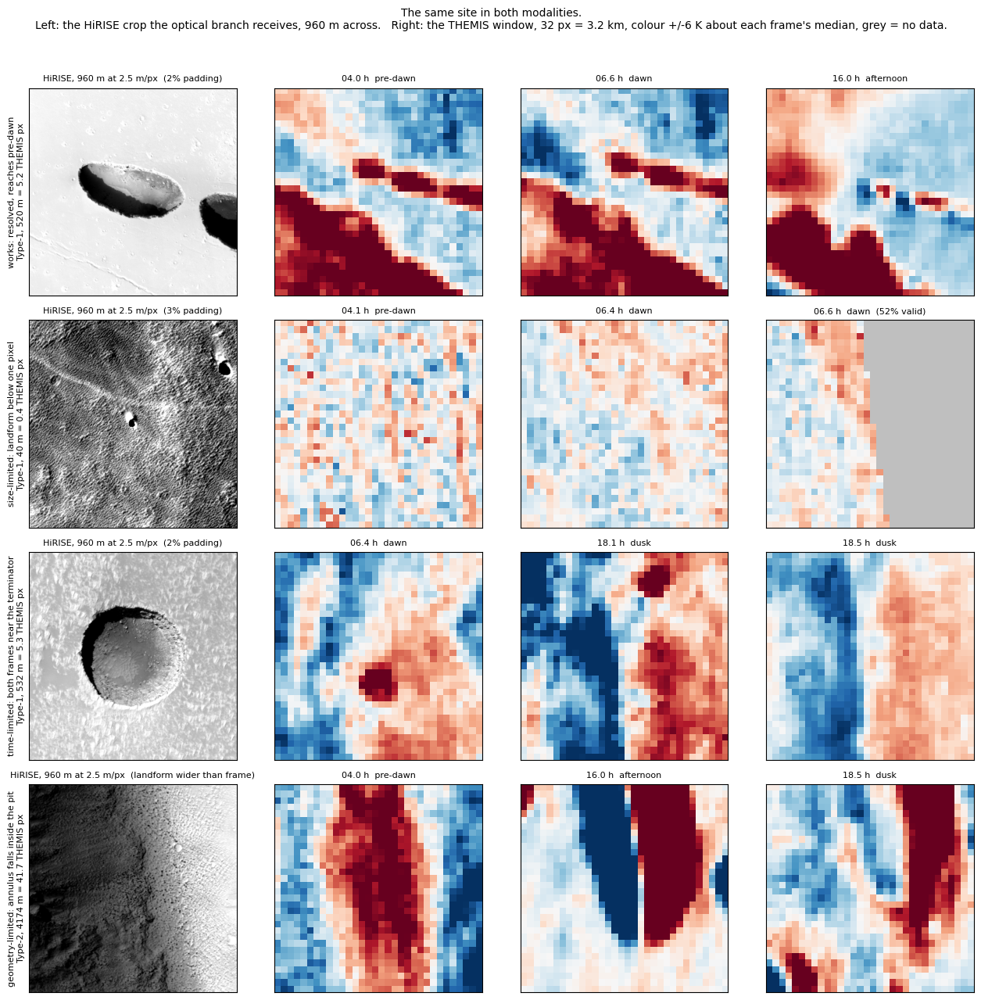
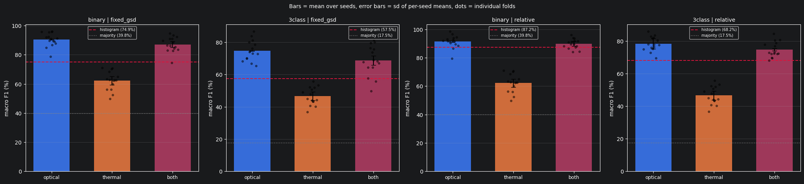
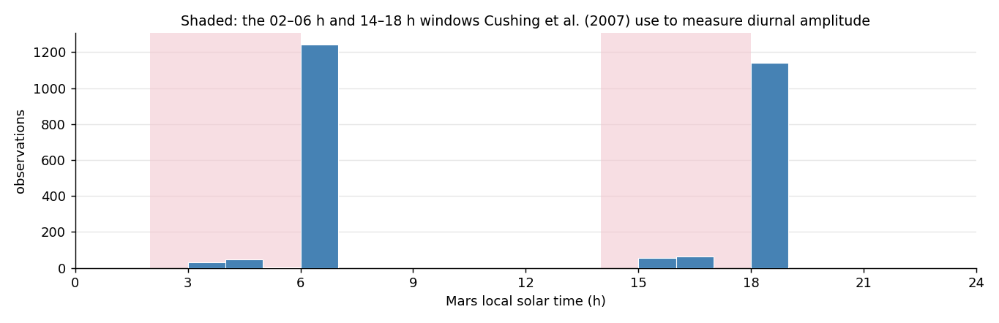

# End-to-End Multimodal Detection of Lunar and Martian Lava Tubes

Optical and thermal orbital data, fused end to end, for classifying candidate
cave entrances on Mars, with a quantitative look at what carries over to the Moon.

📄 **Paper:** [End-to-End Multimodal Detection of Lunar and Martian Lava Tubes](https://www.researchgate.net/publication/415898348_End-to-End_Multimodal_Detection_of_Lunar_and_Martian_Lava_Tubes),
presented at the 77th International Astronautical Congress (IAC 2026), Antalya.

## The problem

Lava-tube skylights are the strongest candidate shelters for long-term
exploration: they shield against radiation and micrometeoroid impacts. Finding
them means telling a **cave-connected pit** from an ordinary collapse pit, and
optical imagery alone struggles because the two look alike from above.

[Cushing et al. (2007)](https://doi.org/10.1029/2007GL030709) give a physical
discriminant: a cave-connected pit swings *less* in temperature over a Martian
day than the pits around it, being warmer than its surroundings before dawn and
cooler than sunlit ground in the afternoon. That suggests fusing high-resolution
imagery with thermal observations.

## The approach

A two-branch network over the 1846 annotated landforms of
[DeepLandforms](https://doi.org/10.1029/2022EA002278) (Nodjoumi et al., 2023):

* an **optical branch**: a fixed 960 m HiRISE crop at 2.5 m/pixel through an
  ImageNet-pretrained ResNet-18;
* a **thermal branch**: three THEMIS windows at native 100 m/pixel, tagged with
  their local solar times and read by a dilated temporal convolution.

The projected embeddings are concatenated and classified. Every result is
scored against baselines that deliberately cannot see morphology, with splits
grouped at HiRISE-product level so no landform, resolution replica or shared
acquisition straddles a fold.



*The two branches share no weights; only their projected embeddings meet.
Arrows are labelled with tensor shapes (batch dimension omitted).*



*What a sample is, and what goes wrong with it. Each row is one landform: the
HiRISE crop the optical branch sees, then its three THEMIS frames as deviation
from each frame's own median. The top row is the case that works: a 520 m pit,
5.2 THEMIS pixels, with a genuine pre-dawn frame. Below it are the three ways
the thermal side fails: a landform smaller than one THEMIS pixel, a site whose
frames both land near the terminator, and one so wide it fills the whole thermal
window.*

## What it finds



* **Optical detection works.** 91.3% accuracy and 90.4 macro F1 on
  skylight-versus-rest, against a 77.8% baseline that sees only a permuted
  intensity histogram and an 84.3% oracle holding each landform's true size.
* **The crop policy is itself a result.** Sizing a crop in proportion to its
  target manufactures a scale cue worth 11 accuracy points. Report a
  window-only baseline or part of the headline number is pipeline artefact.
* **THEMIS cannot contribute at 100 m/pixel.** Fusion *costs* 3.3 macro F1
  points, and a control in which the thermal branch is fed Gaussian noise costs
  nothing, so the penalty is the data, not the fusing. Only 3.2% of available
  observations fall in the pre-dawn window the physics needs, and the median
  skylight is 1.5 THEMIS pixels across.



*Why. Mars Odyssey's orbit has drifted to a dawn/dusk crossing, so 2389 of the
2588 observations covering these sites sit within an hour of 06 h or 18 h. The
shaded bands are the pre-dawn and afternoon windows that
[Cushing et al. (2007)](https://doi.org/10.1029/2007GL030709) use to measure a
diurnal amplitude; 7.8% of the archive falls in either one.*

**And the Moon?** Published Diviner measurements suggest a much stronger
night-time thermal contrast and full diurnal coverage, so thermal fusion should
fare better there. What is missing is a shape-labelled catalogue of lunar pits.
This is an inference from the literature; no lunar experiment was run.

## Repository guide

| Path | What it is |
|---|---|
| `data_overview.ipynb` | **Start here.** Sources, crop policy, splitting, what the data set contains and what the thermal branch can actually see. Builds `annotations.json`. |
| `training.ipynb` | Baselines, the cross-validated modality ablation, the noise control, and the tables the paper quotes. |
| `data/optical/` | Crop planning (`landform_crops.py`) and HiRISE product geometry from PDS ODE. |
| `data/thermal/` | THEMIS retrieval: site definition, footprint queries, window extraction. `thermal_data_collection.ipynb` drives it. |
| `model/` | Dataset (`landform_dataset.py`), architecture (`model.py`), baselines, training and cross-validation utilities. |

## Running it

```bash
pip install -r requirements.txt
```

Two inputs are not in the repository: the
[DeepLandforms tiles](https://zenodo.org/records/6818611) go in
`data/optical/DeepLandforms_dataset/`, and the THEMIS windows are downloaded by
`data/thermal/thermal_data_collection.ipynb`. The
[MGC³ cave catalogue](https://doi.org/10.17189/1519222) (Cushing, 2015) is
included.

Then, in order: `data_overview.ipynb` to build the annotation table,
`thermal_data_collection.ipynb` to fetch the windows, `training.ipynb` to report.
Every run is cached as it finishes, so interrupting and re-running is free.
